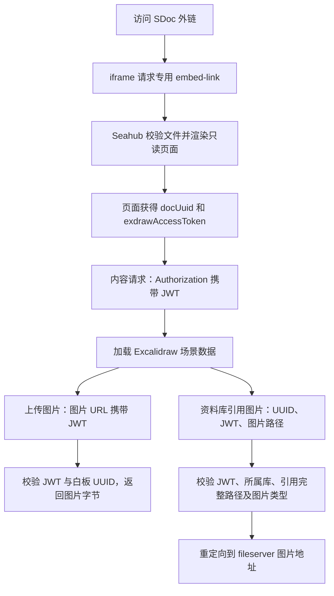

# SDoc 外链中 Excalidraw 文档与图片访问问题分析及解决方案

日期：2026-11-06

适用场景：通过 SDoc 分享链接访问文档中嵌入的 Excalidraw 白板。

实现状态：专用嵌入入口与图片访问修复均已实现。本文按当前代码描述实现，不代表生产环境已发布或浏览器端到端验收已完成。

# 1. 问题原因

## 1.1 问题概述

SDoc 外链访问包含三个相互独立的请求过程：打开嵌入页面、加载 Excalidraw 文档内容、加载白板中的图片。父 SDoc 可以访问，并不意味着浏览器已经具备白板文件及图片接口要求的资料库权限。

| 现象 | 涉及链路 | 原因 |
| --- | --- | --- |
| 外链中无法展示 Excalidraw 文档内容 | 嵌入页面入口及白板内容请求 | 原嵌入链接复用了需要登录和资料库权限的 smart-link，匿名访问无法取得预览页及白板访问令牌 |
| 白板内容可见，但上传图片无法显示 | 白板资源下载接口 | 图片请求原先未携带白板 JWT，依赖登录权限或单个分享 Session |
| 白板内容可见，但资料库引用图片无法显示 | 分享图片接口 | 嵌入页面没有 `sharedToken`，原图片地址却要求真实的文件分享凭证 |

以上鉴权行为已通过源码核对。其中 Session 覆盖问题已有隔离复现；尚未取得用户实际失败图片的完整网络请求，不能认定全部失败都由同一个原因引起。

## 1.2 Excalidraw 文档内容无法访问

原 `generateExdrawReadOnlyLink` 在普通 smart-link 上增加参数：

```text
/smart-link/<uuid>/?readonly=true&filetype=Excalidraw
```

该请求仍由 `view_lib_file_via_smart_link` 处理。这个视图有 `login_required` 装饰器，其只读 Excalidraw 分支还会检查资料库路径权限，并要求预览和下载权限。

因此，匿名用户即使已经通过 SDoc 分享链接打开父文档，也不具备此视图要求的登录状态与资料库权限。请求可能进入登录流程，或在资料库权限检查时被拒绝，导致嵌入白板无法正常初始化。

`readonly=true` 用于选择只读展示分支，不会授予访问权限；`filetype=Excalidraw` 也不能代替服务端根据实际文件名判断类型。

另一个路由因素是：通用 smart-link 路由允许匹配 UUID 后面的任意文件名。如果没有位于其前方的专用路由，`embed-link/` 也会被当作文件名参数接收，仍然进入普通 smart-link 流程。

## 1.3 上传到白板的图片无法访问

白板上传图片使用独立接口：

```text
/api/v2.1/exdraw/download-image/<file_uuid>/<filename>
```

修复前，前端只生成该地址，没有附带 `exdrawAccessToken`。后端 `can_access_exdraw_asset` 仅允许以下两种情况：

1. 登录用户具有白板所在资料库路径的访问权限。
2. `request.session['exdraw_share_session']['file_uuid']` 与请求白板相同。

`exdraw_share_session` 是一个会被覆盖的单独对象。例如，同一浏览器会话先打开白板 A，再打开白板 B，Session 中保存的 UUID 将变为 B。此时匿名用户再次请求 A 的图片，UUID 不匹配，接口返回 HTTP 403。

如果图片请求没有可用的分享 Session，且用户也没有资料库权限，同样会被拒绝。因此文档内容使用 JWT 成功加载，并不能保证依赖 Session 的图片请求成功。

## 1.4 资料库引用图片无法访问

从资料库选择的图片以 `dataURL` 引用保存在白板元素中，例如：

```text
<service_url>/lib/<repo_id>/file/images/example.png?raw=1
```

原预览逻辑会将这类图片地址转换为：

```text
/view-image-via-share-link/?token=<sharedToken>&path=<image_path>
```

嵌入视图传入了 `excalidraw_access_token`，但没有传入 `shared_token`。模板生成的 `window.shared.pageOptions.sharedToken` 因此为空，进入这条图片分支后，接口会因缺少 `token` 返回 HTTP 400：`invalid params`。

另外，原逻辑会在处理 `dataURL` 时覆盖上传图片地址。因此，只修改上传图片的 `getImageUrl`、让其附带 JWT，不能同时修复资料库引用图片。

## 1.5 两种令牌的含义不同

| 项目 | `sharedToken` | `exdrawAccessToken` |
| --- | --- | --- |
| 来源 | 数据库中的 `FileShare` 分享记录 | 服务端签发的白板 JWT |
| 校验方式 | 查询分享记录，并检查有效期、访问范围、密码等 | 校验签名、过期时间及白板文件 UUID |
| 当前有效期 | 由分享记录配置，可以没有过期时间 | 当前签发逻辑为 3 天 |
| 是否对应独立外链 | 对应 `/f/<token>/` | 不对应 `FileShare` 记录 |
| 嵌入页是否已经提供 | 未提供 | 已提供 |

原分享图片接口不能识别任意随机字符串或白板 JWT。它还只接受 Markdown、Excalidraw 类型的分享文件，不能直接使用父 SDoc 的分享 Token 读取白板图片。

# 2. 解决方案

## 2.1 总体思路

为外链嵌入场景提供独立的只读页面入口，复用已有白板 JWT 的签发与校验逻辑，使文档内容和图片请求携带各自需要的访问凭证。

| 访问对象 | 修复方式 | 授权范围 |
| --- | --- | --- |
| Excalidraw 嵌入页面 | 使用专用 `embed-link` 路由，直接渲染预览页 | 根据 UUID 定位存在的、非加密资料库中的 Excalidraw 文件 |
| Excalidraw 文档内容 | 复用现有内容接口，使用嵌入页面提供的 JWT | JWT 对应的白板文件 |
| 白板上传图片 | 图片 URL 携带 JWT，后端复用现有校验函数 | 请求 UUID 对应的白板图片资源目录 |
| 资料库引用图片 | 分享图片接口增加白板 JWT 分支 | 当前白板实际引用的同库图片完整路径 |

当前方案不在访问嵌入页面时新建 `FileShare`。这样无需新增分享记录或令牌签发机制，也不会因为一次页面访问额外生成持久分享链接。

## 2.2 修复后的访问链路



已有真实 `sharedToken` 的资料库图片请求继续走原 FileShare 分支，保留分享密码、有效期和用户范围检查。

# 3. 方案详细内容

## 3.1 调整只读嵌入链接的生成逻辑

SDoc 和 Wiki 两处 `generateExdrawReadOnlyLink` 保持一致：

```js
seafileAPI.getInternalLink(params.repoID, params.filePath).then((res) => {
  const link = `${res.data.smart_link}embed-link/`;
  if (params?.onSuccess) {
    params.onSuccess(link);
  }
});
```

生成的链接为：

```text
/smart-link/<uuid>/embed-link/
```

专用路由应位于通用 smart-link 路由之前，并兼容末尾有、无斜杠：

```python
re_path(
    r'^smart-link/(?P<dirent_uuid>[-0-9a-f]{36})/embed-link/?$',
    view_lib_file_via_embed_link,
    name='view_lib_file_via_embed_link',
)
```

此修改影响新生成的嵌入链接，不会自动重写已保存到 SDoc 中的旧链接。仍保存旧 smart-link 的文档需要更新嵌入地址或重新生成链接。

## 3.2 专用嵌入视图生成只读访问凭证

`view_lib_file_via_embed_link` 不要求登录，按以下顺序处理：

1. 根据 URL 中的 UUID 获取 `FileUUIDMap`。
2. 拒绝不存在的映射、目录及非 Excalidraw 文件。
3. 检查资料库与文件存在，并拒绝加密资料库。
4. 获取白板的 `file_uuid`，使用已有 `gen_exdraw_access_token` 签发 `permission='r'` 的 JWT。
5. 设置预览模板的只读权限标记并传入页面初始化数据。
6. 保留现有 `exdraw_share_session` 写入逻辑，兼容旧图片访问方式。
7. 直接渲染 `shared_file_view_react.html`。

主要初始化数据如下：

| 后端字段 | 前端字段或用途 |
| --- | --- |
| `file_uuid` | `docUuid`，用于标识当前白板 |
| `excalidraw_access_token` | `exdrawAccessToken`，用于内容和图片鉴权 |
| `excalidraw_server_url` | `exdrawServerUrl`，用于请求白板内容服务 |
| `file_perm='r'`、`can_edit_file=False` | 只读展示配置 |
| `permissions.can_edit=False`、`permissions.can_download=False` | 模板中的编辑、下载权限标记 |
| `raw_path=''` | 不向此嵌入页提供白板文件的原始下载地址 |

`embed-link` 直接返回预览 HTML，不通过 HTTP 302 跳转到普通文件预览页。模板中的权限标记用于页面配置，不应被解释为阻止任何形式的内容导出。

## 3.3 文档内容复用已有 JWT 请求逻辑

嵌入页初始化后，`EditorApi.getExdrawContent` 使用已有请求方式加载场景数据：

```js
const url = `${exdrawServerUrl}/api/v1/exdraw/${docUuid}/`;
return axios.get(url, {
  headers: { Authorization: `Token ${exdrawAccessToken}` },
});
```

本次修复提供正确的嵌入入口和令牌，不新增白板内容接口，也不改写 Excalidraw 内容服务的实现。

JWT 沿用现有 HS256 签发方式，包含 `file_uuid`、`permission`、`exp` 等字段。Seahub 图片接口复用 `is_valid_exdraw_access_token` 校验签名、有效期和文件 UUID；图片路径的授权由图片接口继续完成。

## 3.4 上传图片请求携带白板 JWT

`SimpleViewer.getImageUrl` 对上传图片生成以下地址：

```text
/api/v2.1/exdraw/download-image/<file_uuid>/<filename>?access_token=<encoded_jwt>
```

文件名和令牌分别使用 `encodeURIComponent` 编码。没有 JWT 时，保留不带令牌的原地址。

后端处理顺序为：

1. `ExdrawDownloadImage` 拒绝包含目录部分的文件名，防止跳出白板资源目录。
2. 获取白板 UUID 映射，检查图片扩展名是否受支持。
3. `can_access_exdraw_asset` 优先检查查询参数中的 JWT，要求其文件 UUID 与请求一致。
4. JWT 未通过时，仍可由已有登录权限或分享 Session 独立授权；没有任何合法凭证则返回 HTTP 403。
5. 从当前白板资源目录读取图片，通过 Seahub 返回图片字节。

图片资源目录沿用现有布局：

```text
/images/exdraw/<file_uuid>/<filename>
```

每个白板的图片请求因此可以使用自己的 JWT，不再仅依赖 Session 中最后打开的白板记录。

## 3.5 资料库引用图片接入白板 JWT

前端从 `dataURL` 解析资料库引用地址，确认其来源、资料库路径前缀和 `raw=1` 参数。识别到当前资料库图片时，提取图片路径并通过 `URLSearchParams` 生成请求。

没有真实 `sharedToken`、但有白板 JWT 时，使用：

```text
/view-image-via-share-link/?file_uuid=<uuid>&access_token=<encoded_jwt>&path=<encoded_image_path>
```

后端新增分支执行以下检查：

1. 参数完整，UUID 格式合法。
2. JWT 签名、有效期、文件 UUID 校验通过。
3. 通过服务端 UUID 映射取得资料库和白板路径，忽略客户端试图指定的资料库归属。
4. 映射对应存在的 Excalidraw 文件，所属资料库存在且未加密。
5. 读取白板文件内容，通过 `is_exdraw_image_referenced` 检查引用关系。
6. 规范化图片路径，检查其类型为 `IMAGE` 或 `SVG`。
7. 确认图片存在，复用已有 fileserver 链接生成逻辑，返回 HTTP 302 重定向。

`is_exdraw_image_referenced` 的校验范围为：

- 场景必须是合法 JSON，且 `elements` 为数组。
- 仅接受未删除的 `image` 元素。
- 图片引用必须匹配当前服务来源、部署路径和白板所属资料库。
- 引用 URL 必须具有 `raw=1` 参数。
- 对引用 URL 路径解码一次，再对引用路径与请求路径进行规范化和完整路径比较。

完整路径校验可以区分 `/images/example.png` 与 `/private/example.png`，不能只凭同名文件授权。请求路径也不能因重复解码，将字面量 `%20` 错当成空格。

前端对不属于当前资料库原图形式的 URL 保留原地址，不附加白板凭证；这不代表为第三方或其他资料库图片新增了访问授权。

## 3.6 兼容已有 FileShare 分享逻辑

资料库图片的前后端分支选择保持一致：

| 凭证情况 | 处理方式 |
| --- | --- |
| 有非空 `sharedToken` | 使用原 FileShare 分享分支 |
| 没有 `sharedToken`，有 `exdrawAccessToken` | 使用新增的白板 JWT 分支 |
| 两者都没有 | 不授予额外权限 |

后端收到非空 `token` 时优先执行原分享记录检查。即使同一请求还携带有效 JWT，也不会在密码、用户范围或有效期检查失败后回退到 JWT 分支。

访问嵌入页面不创建 `FileShare`，也不将 JWT 写入 `sharedToken`。父 SDoc 的分享 Token 仍不能替代白板分享凭证。

## 3.7 涉及文件

| 文件 | 作用 | 当前状态 |
| --- | --- | --- |
| [external-operations.js](../frontend/src/pages/sdoc-editor/external-operations.js) | SDoc 中生成专用嵌入链接 | 当前分支已有 |
| [main-panel.js](../frontend/src/pages/wiki2/main-panel.js) | Wiki 中同步生成专用嵌入链接 | 当前分支已有 |
| [urls.py](../seahub/urls.py) | 专用嵌入路由优先于通用 smart-link | 当前分支已有 |
| [file.py](../seahub/views/file.py) | 嵌入页初始化；资料库引用图片的双凭证分支 | 图片部分为本次修复 |
| [editor-api.js](../frontend/src/pages/excalidraw-viewer/editor-api.js) | 携带 JWT 请求 Excalidraw 文档内容 | 复用，未修改 |
| [simple-viewer.js](../frontend/src/pages/excalidraw-viewer/simple-viewer.js) | 统一生成两类图片的最终请求地址 | 本次修复 |
| [utils.py](../seahub/exdraw/utils.py) | 图片 JWT 鉴权及完整引用路径校验 | 本次修复 |
| [apis.py](../seahub/exdraw/apis.py) | 上传图片文件名限制及资源下载 | 本次修复 |

## 3.8 验证记录与验收范围

修复过程中的验证记录如下。测试文件目前已从工作区移除，以下用例通过记录对应此前验证，不代表本次提交重新执行了这些测试。

| 验证项 | 结果 | 范围 |
| --- | --- | --- |
| 前端针对性测试 | 11 个用例通过 | 两类图片 URL、多白板凭证、路径及令牌编码、服务子路径、原分享凭证选择 |
| 后端隔离测试 | 33 个用例通过 | 真实 JWT 校验、Session 覆盖、跨白板访问、完整路径与所属库、图片类型、原分享检查兼容 |
| ESLint、Python 语法及差异检查 | 通过 | 修改文件及新增测试 |
| Django 常规测试入口 | 未能启动测试 | 现有 `seafevents` 初始化错误：`AttributeError: 'NoneType' object has no attribute 'init_db_session_class'` |
| 浏览器及 Excalidraw 内容服务端到端验证 | 尚未完成 | 需要使用实际 SDoc 外链验收 |

后端隔离测试使用真实 PyJWT、Django 请求与响应对象，提取当前生产函数和处理器执行，并替换外部服务依赖；它没有覆盖完整 Django、DRF 中间件和服务集成流程。

本次提交不包含上述前后端回归测试文件。

实际外链验收应覆盖：匿名打开白板内容、上传图片、资料库引用图片、同一 SDoc 中多个白板、无分享 Session 的图片请求，以及旧 FileShare 密码和有效期限制。更新旧嵌入地址后，应检查浏览器最终请求是否已经使用 `embed-link/`。

## 3.9 方案边界

当前 JWT 的有效期仍为 3 天，本次没有新增长时间打开页面后的自动续期机制。

嵌入入口根据白板 UUID 提供访问能力，没有绑定父 SDoc 的分享凭证。取得嵌入 URL 的访问者可以直接访问该入口；父 SDoc 分享撤销、密码变更或到期，不会由本次修复自动联动到白板入口和已签发 JWT。该访问边界需要在人工审核时明确接受。

图片 URL 会携带访问令牌，日志和错误上报不应记录完整凭证。图片 JWT 分支仅用于读取，不扩展白板写入权限。

本次实现不新增依赖、数据库迁移或配置项。发布前仍需使用实际 SDoc 外链完成浏览器及服务端到端验收。
